

  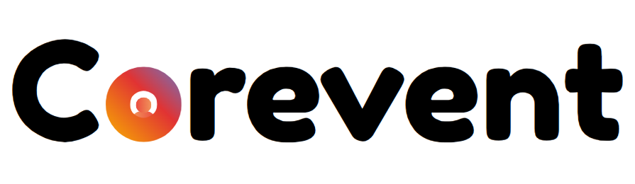

# Corevent

Criação e gerenciamento de eventos híbridos

[Documentação em .docx](https://github.com/corevent/documentation/blob/main/documentacao.docx)

  
<strong>📑 Sumário</strong>

- [1. Introdução](#1-introdução)
  - [Objetivos](#objetivos)
  - [Metodologia](#metodologia)
- [2. Requisitos](#2-requisitos)
  - [Histórias do Usuário](#histórias-do-usuário)
  - [Requisitos funcionais](#requisitos-funcionais)
  - [Requisitos não funcionais](#requisitos-não-funcionais)
- [3. Modelo de casos de uso](#3-modelo-de-casos-de-uso)
  - [Casos de uso resumidos](#casos-de-uso-resumidos)
  - [Casos de uso detalhados](#casos-de-uso-detalhados)
  - [BPMN](#bpmn)
- [4. Modelo do banco de dados](#4-modelo-do-banco-de-dados)
- [5. Banco de dados](#5-banco-de-dados)
- [6. Diagrama de classes](#6-diagrama-de-classes)
- [7. Estudo de viabilidade](#7-estudo-de-viabilidade)
- [8. Regras de negócio (Modelo canvas)](#8-regras-de-negócio-modelo-canvas)
- [9. Design](#9-design)
- [10. Protótipo](#10-protótipo)
- [11. Aplicação](#11-aplicação)
- [12. Considerações finais](#12-considerações-finais)
- [13. Referências](#13-referências)

# 1. Introdução

Reconhecendo a necessidade de melhorar a criação e o gerenciamento de eventos, sejam eles presenciais ou digitais, o software Corevent surgiu como uma solução para esse problema. A partir dele você conseguirá criar e gerenciar eventos, podendo também se registrar nos já existentes.

## Objetivos

### Geral

Centralizar e facilitar a criação e gerenciamento de evento por parte dos organizadores, e a visualização dos conteúdos e informações dos eventos por parte dos seus participantes.

### Específicos

- Identificar sites semelhantes na web.
- Levantar requisitos funcionais.

## Metodologia

O cronograma está registrado no Trello para melhor organização, o modelo escolhido pela equipe foi o Kanban, pois consideramos esse o mais adequado para o projeto.

O wireframe e o protótipo foram desenvolvidos no Figma, a codificação será feita no Visual Studio Code e o versionamento do código no GitHub.

# 2. Requisitos

Um documento de requisitos descreve as funcionalidades, características e restrições que um sistema deve ter para atender às necessidades dos usuários e stakeholders. Esse documento serve para orientar os desenvolvedores, designers e demais membros da equipe oferecendo uma visão detalhada dos requisitos funcionais e não funcionais que moldarão a construção do software.

O documento abrange aspectos como especificações técnicas, interfaces do usuário e critérios de desempenho, o documento de requisitos estabelece uma base sólida para a implementação, teste e validação do software. Essa abordagem assegura a precisão entre a visão do cliente e a solução final, contribuindo para o sucesso do projeto.

## Histórias do Usuário

- Como participante de eventos, quero poder visualizar quais atrações o evento terá, bem como os seus respectivos horários, convidados e outras informações que sejam relevantes
- Como participante, quero poder realizar a compra dos ingressos do evento dentro da plataforma, centralizando toda a interação em um único lugar
- Como organizador, quero poder criar um evento dentro da plataforma, podendo definir quais atrações / palestras existirão, bem como os seus horários, data e todas as informações do evento
- Como organizador, quero adicionar pessoas para me ajudar em um evento criado(staffs), onde essas poderão me auxiliar de todas as formas que forem úteis para mim
- Como participante, quero poder visualizar as informações da minha conta, como dados pessoais, ver os eventos que já participei, meus ingressos, entre outras informações relevantes
- Como organizador, quero conseguir gerenciar a venda e controle de ingressos dentro da plataforma, como quantidade, preço, visualizar vendas, e outros detalhes que sejam úteis para a venda de ingressos.

## Requisitos funcionais

| Código | Título | Descrição |
| --- | --- | --- |
| RF 1 | Cadastrar-se na aplicação | O sistema deve permitir o cadastro de novos usuários na plataforma Campos: Nome, E-mail de preferência e uma senha segura. |
| RF 2 | Logar na aplicação | O sistema deve permitir que o usuário possa se autenticar na plataforma, caso já tenha uma conta. |
| RF 3 | Criação de evento | Um usuário poderá criar um evento dentro da plataforma, se tornando assim o seu administrador, devendo incluir suas respectivas informações como nome, local, data e horário. |
| RF 4 | Editar um evento existente | O administrador do evento pode editar as suas informações, como quantidade de pessoas, se será um evento gratuito ou não, valor do ingresso, descrições e mídias |
| RF 5 | Alterar informações pessoais | O usuário estando logado na aplicação, poderá alterar suas informações, como senha, endereço de e-mail, nome, e demais informações que sejam relevantes. |
| RF 6 | Visualizar informações pessoais | O usuário estando logado na aplicação, poderá visualizar todas as suas informações pessoais, como data de criação, nome, eventos que já participou, e-mail e senha de acesso. |
| RF 7 | Convidar pessoas para colaborar em um evento | Ao criar um evento, seu criador poderá convidar novos membros para te auxiliar no gerenciamento, como adicionar informações, mídias, alterar datas e horários, entre outras informações. |
| RF 8 | Realizar a compra de um ingresso | Os usuários poderão realizar a compra do ingresso para algum evento de sua preferência dentro da plataforma do sistema, sendo direcionado para a tela de pagamento utilizada. |
| RF 9 | Visualizar as informações do seu ingresso já adquirido | Após a realização da compra de um ingresso, o seu dono poderá visualizar todas as suas informações na plataforma, bem como visualizar todos os ingressos que ele já tenha adquirido. |
| RF 10 | Visualizar detalhes de um evento antes de comprar um ingresso | Antes de realizar a compra, um usuário pode ver todas as informações de um evento, como fotos, data e descrições, para que ele possa avaliar e decidir se irá ou não adquirir um ingresso. |
| RF 11 | Recebimento de e-mail ao realizar cadastro | A plataforma deverá enviar um e-mail ao usuário quando ele se cadastrar, dando as boas-vindas e confirmando que a sua conta foi feita com sucesso dentro do sistema. |
| RF 12 | Receber um e-mail ao ser convidado para ajudar em um evento | Quando um usuário for convidado para colaborar em um evento, ele receberá uma mensagem em seu endereço de e-mail comunicando esse convite, dando a possibilidade de aceitar ou não, além de trazer todas as informações relevantes. |
| RF 13 | Gerenciar pessoas utilizando QR Code | Membros da equipe do evento (Organizador ou Staff) podem ler o QR Code do participante via dispositivo móvel para validar a entrada e registrar o check-in no sistema. |
| RF 14 | Visualizar participantes de um evento | A equipe do evento tem acesso à lista de inscritos e ao status de credenciamento (quem já fez check-in e quem falta entrar). |
| RF 15 | Realizar o credenciamento via celular | Quando um admin utilizar o seu celular para o escanear o QR Code do participante, o app deverá mostrar se aquela pessoa é um participante, ou um ajudante do evento afim de poder controlar o fluxo de pessoas melhor e ter um maior controle |
| RF 16 | Leitura automática de QR Code via Totem IoT | O sistema deverá disponibilizar um modo de operação exclusivo no aplicativo mobile para tablets fixos (totens), com a câmera aberta para leitura automática de QR Code. Ao ler o código, o app deverá chamar a API para validação e exibir na tela do totem se o ingresso do participante foi validado com sucesso ou não. |
| RF 17 | Modo totem com acesso restrito | O modo totem deverá possuir um mecanismo de login/logout para que apenas pessoas autorizadas (organizadores ou staffs) consigam acessar, configurar e sair da tela do totem. |
| RF 18 | Exibição do resultado da validação no totem | Após a leitura do QR Code, o totem deverá exibir de forma clara e visual se o ingresso foi validado com sucesso (entrada liberada) ou se a validação falhou (entrada não autorizada). O sistema não realizará o bloqueio físico da entrada, a decisão de permitir ou barrar o acesso continua a critério da organização do evento (ex.: segurança na porta). |
| RF 19 | Funcionalidades administrativas restritas à web | Todas as funcionalidades de administrador de evento (criar evento, editar evento, gerenciar ingressos, convidar colaboradores, visualizar participantes, entre outras) deverão estar disponíveis exclusivamente na plataforma web. O aplicativo mobile não deverá conter nenhuma funcionalidade administrativa, sendo utilizado exclusivamente para o modo totem de credenciamento. |

## Requisitos não funcionais

| Código | Descrição |
| --- | --- |
| RNF 1 | A aplicação deve ser de fácil navegação; |
| RNF 2 | A aplicação deve ser segura; |
| RNF 3 | A aplicação deve estar sempre disponível; |
| RNF 4 | A aplicação deve ser responsiva |

# 3. Modelo de casos de uso

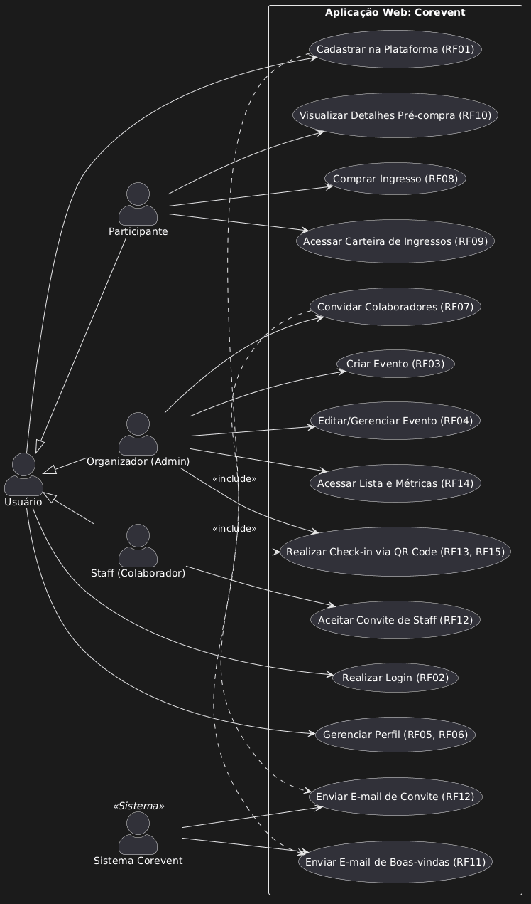

Figura 2 - Casos de Uso

Fonte: Os autores (2026).

## Casos de uso resumidos

### Caso de uso: Cadastrar na plataforma

Visão geral: O usuário acessará o app, e caso não tenha uma conta, ele vai para o formulário de cadastro, onde precisará informar as seguintes informações: Nome completo, e-mail, senha e a sua data de nascimento.

### Caso de uso: Realizar login

Visão geral: O usuário cadastrado deve informar seu e-mail e senha no formulário de login. Em seguida, o sistema verificará essas informações e, se estiverem corretas, redirecionará o usuário para a tela inicial do site.

### Caso de uso: Gerenciar perfil

Visão geral: O usuário poderá visualizar o seu perfil e alterar as suas informações, como endereço de e-mail, senha de acesso e outras informações que forem possíveis alterar.

### Caso de uso: Visualizar detalhes pré-compra

Visão geral: Antes de realizar a compra, um usuário pode ver todas as informações de um evento, como fotos, data e descrições, para que ele possa avaliar e decidir se irá ou não adquirir um ingresso.

### Caso de uso: Comprar ingresso

Visão geral: Os usuários poderão realizar a compra do ingresso para algum evento de sua preferência dentro da plataforma do sistema, sendo direcionado para a tela de pagamento utilizada.

## Casos de uso detalhados

### Caso de Uso: Realizar Cadastro

Ator Principal: Todos os usuários

#### Interesses e Interessados:

Organizador: Deseja ter uma conta na plataforma para que possa anunciar os eventos que ele for organizar, para que os interessados possam saber mais sobre e que consigam realizar a compra dos ingressos

Participante: Deseja ter um cadastro ativo no sistema para visualizar novos eventos, ver suas informações e comprar os seus ingressos

#### Pré-Condições:

- O sistema deve estar online.
- O usuário não deve estar logado.

#### Pós-Condições:

- Usuário cadastrado com sucesso no banco de dados.
- Sessão iniciada automaticamente ou redirecionamento para o login.
- E-mail de boas-vindas enviado.

#### Cenário de Sucesso Principal:

1. O usuário acessa a página de "Cadastro".
2. O usuário preenche os campos obrigatórios: Nome, E-mail, Senha e data de nascimento
3. O usuário clica em "Finalizar Cadastro".
4. O sistema criptografa a senha e salva os dados.
5. O sistema exibe mensagem de sucesso e redireciona o usuário para o Painel ou Home.

#### Fluxos Alternativos:

1A – Dados Inválidos: Se o e-mail for inválido ou a senha não atingir os requisitos de segurança, o sistema aponta o erro e solicita a correção.

2A – Usuário já cadastrado: Se o e-mail ou CPF/CNPJ já estiverem na base, o sistema sugere a recuperação de senha.

3A – Falha na Conexão: Caso o banco de dados esteja offline, o sistema informa que houve um erro técnico e pede para tentar novamente em instantes.

#### Extensões e Requisitos Relacionados:

RF 1 – Cadastrar-se na aplicação

### Caso de Uso: Organizar Evento

Ator Principal: Usuário Organizador

#### Interesses e Interessados:

Organizador: Deseja organizar eventos com as configurações disponíveis.

Participantes: Visualizar e participar de eventos.

#### Pré-Condições:

- O usuário deve estar autenticado no sistema
- O usuário deve ser um organizador
- Em caso de eventos pagos, o organizador deve ter dados bancários cadastrados para a transferência

#### Pós-Condições:

O evento é cadastrado com as configurações impostas pelo organizador: preço, tipos de ingressos, lote, lotação e data

#### Cenário de Sucesso Principal

1. O organizador acessa o sistema Corevent.
2. Seleciona a opção “Organizar evento” no painel de eventos.
3. Seleciona usuários para colaborar com a organização
4. Seleciona se o evento será gratuito ou pago

Preenche os seguintes campos (gratuitos e pagos)

- Data e horário do evento
- Local
- Imagens (opcional)
- Flag que define se será apenas para maiores de idade

Caso o evento seja pago, preenche os seguintes campos:

Campos obrigatórios:

- Título
- Capacidade máxima
- Tipo de localização (presencial, online ou híbrido)
- Data e hora de início
- Data e hora de fim
- Categoria (música, esportes, tecnologia etc.)
- Flag para marcar se o evento é para maiores de 18 anos
- Status (rascunho ou em aberto)

Campos obrigatórios apenas se o tipo de localização for presencial ou híbrido

- Nome do local
- Cidade
- CEP
- Bairro
- Rua
- Número

Campos opcionais

- Descrição
- Banner do evento
- Complemento

5. O organizador finaliza o cadastro.
6. O sistema salva a informação no banco de dados.
7. O organizador recebe uma mensagem de confirmação: “Evento criado com sucesso!”

#### Fluxos Alternativos

1A – Campos obrigatórios não preenchidos:

Se algum campo não for preenchido, o sistema exibe:→ “Preencha todos os campos obrigatórios antes de continuar.”

2A – Erro no upload de imagens:

Se a imagem não for inserida/enviada corretamente, o sistema exibe:

→ “Erro ao enviar imagem, tente novamente”.

3A – Colaborador não encontrado:

Caso o usuário colaborador não seja encontrado, o sistema exibe:

→ “Usuário não encontrado”.

4A – Erro ao cadastrar evento:

Se ocorrer um erro ao cadastrar o evento, o sistema exibe:

→ “Ocorreu um erro ao criar evento”.

#### Extensões e Requisitos Relacionados

RF 3 – Criação de evento

RF 7 – Convidar pessoas para colaborar em um evento

## BPMN

Segue abaixo alguns dos diagramas BPMN que realizamos para o nosso projeto:

  
<strong>Fluxo de compra de ingresso</strong>

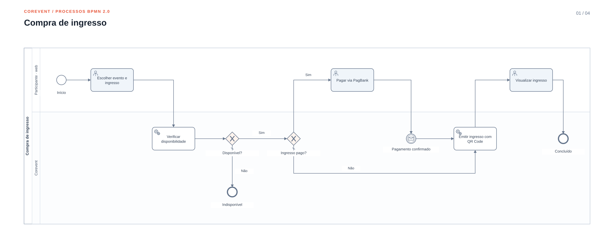

Figura 5 - Fluxo de compra de ingresso

Fonte: Os autores (2026)

[Arquivo editável BPMN](assets/bpmn/01-compra-ingresso.bpmn) · [Imagem em PNG](assets/bpmn/01-compra-ingresso.png)

  
<strong>Fluxo de convite de colaborador</strong>

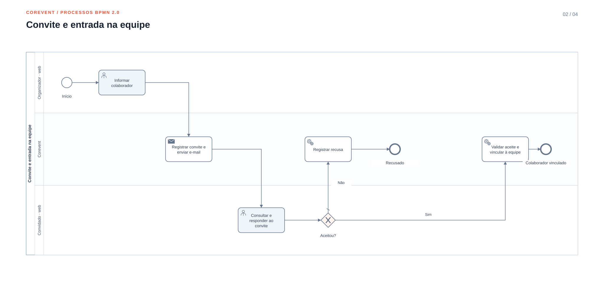

Fonte: Os autores (2026).

[Arquivo editável BPMN](assets/bpmn/02-convite-colaborador.bpmn) · [Imagem em PNG](assets/bpmn/02-convite-colaborador.png)

  
<strong>Sessão de credenciamento no totem</strong>

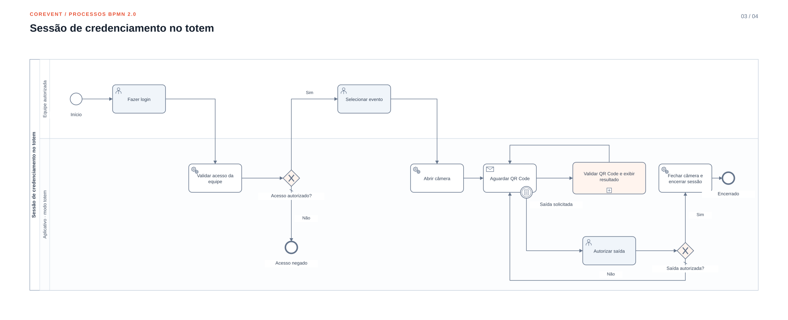

Fonte: Os autores (2026).

[Arquivo editável BPMN](assets/bpmn/03-sessao-totem.bpmn) · [Imagem em PNG](assets/bpmn/03-sessao-totem.png)

  
<strong>Checkin Evento</strong>

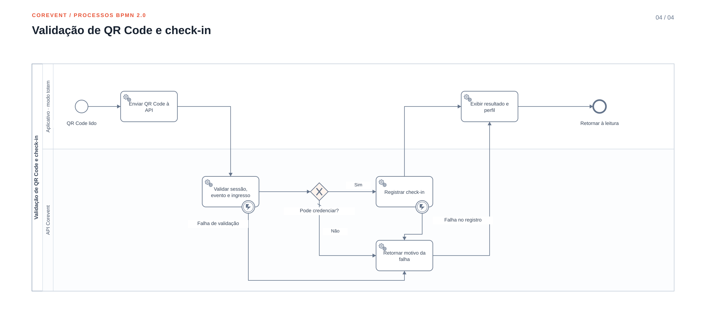

Figura 7 – Checkin Evento

Fonte: Os autores (2026)

[Arquivo editável BPMN](assets/bpmn/04-validacao-qr-code.bpmn) · [Imagem em PNG](assets/bpmn/04-validacao-qr-code.png)

# 4. Modelo do banco de dados

Optamos pelo uso de um banco de dados relacional (PostgreSQL) por garantir persistência e integridade dos dados em todas as fases da aplicação. O uso do PostgreSQL permite estruturar e relacionar as informações de forma consistente e bem-organizada no formato de tabelas, tornando o sistema robusto e confiável.

# 5. Banco de dados

Atualmente, o banco de dados de produção é PostgreSQL hospedado na plataforma Neon. No ambiente de testes, o PostgreSQL é hospedado no Cloud SQL, serviço gerenciado de banco de dados do GCP.

# 6. Diagrama de classes

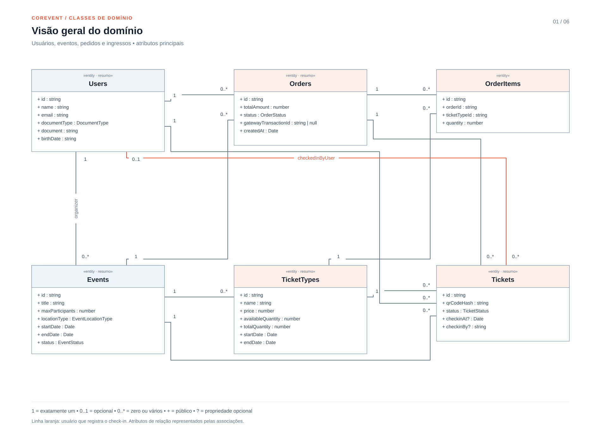

# 7. Estudo de viabilidade

## Viabilidade Técnica

Quais tecnologias e recursos são necessários para desenvolver e manter o projeto? O sistema será desenvolvido utilizando Flutter para o mobile, Node.js com o framework NestJS para a API, React para o website e PostgreSQL para o banco de dados.

A equipe possui o conhecimento técnico necessário para implementar o projeto? Sim. Durantes os semestres cursados, a equipe aprimorou seus conhecimentos técnicos permitindo a implementação com eficiência.

## Viabilidade Econômica

Quais custos estão envolvidos no desenvolvimento e manutenção do projeto?Os principais custos envolvem a hospedagem em nuvem do sistema.As ferramentas de desenvolvimento adotadas (Node.js, Flutter e PostgreSQL) são de uso gratuito, o que reduz significativamente o investimento inicial e os custos de manutenção.

Será necessário investimento em mão de obra?Não será necessário investimento em mão de obra, já que que o desenvolvimento será realizado pelos próprios alunos, evitando despesas desnecessárias.

O projeto traz benefícios que justificam o investimento?

O sistema proporcionará uma facilidade maior para participantes conhecerem e participarem de eventos, auxiliando também os organizadores para criarem e divulgarem os seus eventos. Comparando os benefícios propostos com os custos de manutenção e hospedagem, é uma troca muito favorável.

## Viabilidade de Mercado

Existe demanda suficiente para o produto ou serviço? Sim. Há uma demanda constante por soluções que facilitem participantes a conhecerem novos eventos, bem como ajudar os participantes a criar a sua identidade e divulgação digital, controlar as informações do evento e gerir suas vendas

Como o projeto se diferencia da concorrência? O sistema está sendo projetado para fornecer uma maior agilidade e comodidade para os seus usuários, por integrar tudo em um só aplicativo, as pessoas conseguem compartilhar com pessoas próximas, realizar a compra de ingressos e fazer o seu check-in via aplicativo.

## Viabilidade Legal

O projeto está em conformidade com as leis e regulamentações vigentes? O projeto está em plena conformidade com as normas vigentes, especialmente com a Lei Geral de Proteção de Dados (LGPD).

Como serão protegidos os dados dos usuários e a propriedade intelectual? A plataforma implementará políticas claras de privacidade, consentimento e armazenamento seguro de dados, assegurando a confidencialidade das informações pessoais e acadêmicas dos usuários. Além disso, serão adotadas medidas para garantir a proteção da propriedade intelectual do sistema.

## Viabilidade Organizacional

A equipe e a estrutura organizacional têm capacidade para executar o projeto? A equipe possui capacidade técnica e organizacional para executar o projeto, com divisão clara de responsabilidades e flexibilidade para se adaptar a eventuais desafios durante o desenvolvimento.

O projeto pode ser sustentado financeiramente a longo prazo? O projeto apresenta baixo custo operacional, limitado basicamente à hospedagem em nuvem, o que torna sua manutenção financeiramente sustentável a longo prazo.

# 8. Regras de negócio (Modelo canvas)

Para a elaboração do modelo de negócio, foi utilizado o Modelo de Negócio Canvas, uma abordagem que permite planejar de forma clara e visual os principais aspectos da aplicação web, incluindo o público-alvo, a proposta de valor, os canais de distribuição, a estrutura de custos e outros elementos essenciais para seu funcionamento.  A Figura 1 apresenta o resumo do modelo de negócios elaborado no Canvas.

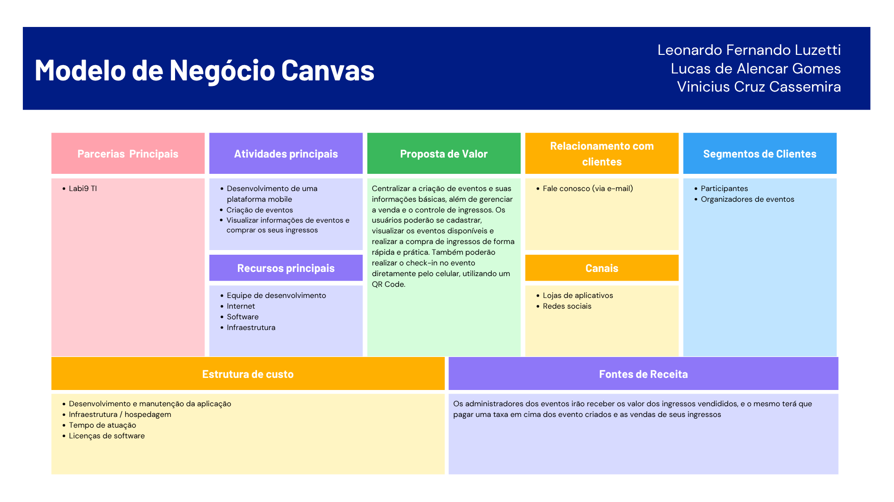

Figura 1 - Modelo Canvas.

Fonte: Os autores (2026).

## O QUE SERÁ ELABORADO?

Proposta de valor: Será desenvolvida uma plataforma mobile educacional denominada Corevent. Apartir dele, administradores poderão criar eventos, gerenciar a quantidade e preço dos ingressos, datas e locais relevantes. Por outro lado, usuários poderão visualizar as informações dos eventos existentes, e realizar a compra de ingresso, se for relevante para ele. Quando o participante for entrar em um evento, ele poderá fazer o credenciamento a partir do seu dispositivo móvel.

## COMO SERÁ ELABORADO?

Atividades principais: As principais atividades envolvem: Desenvolvimento da plataforma web e mobile; Criação e gerenciamento de eventos; visualizar informações de eventos e realizar a compra de seus ingressos.

Parcerias Principais: A padrinha do nosso projeto e principal parceira é a empresa Labi9 Tecnologia da Informação.

Recursos principais: Equipe de Desenvolvimento; Internet; Infraestrutura.

## PARA QUEM SERÁ ELABORADO?

Relação com o cliente: O relacionamento será mantido por meio de funcionalidades integradas à plataforma, como o “Fale Conosco”, possibilitando o envio de dúvidas, sugestões e feedback diretamente para a equipe responsável, garantindo comunicação rápida e eficiente.

Segmento de clientes: O sistema é voltado para a criação e participação de eventos: Administradores e participantes de eventos serão os principais clientes da plataforma.

Canais: O principal canal de acesso será o site da plataforma, acessível por navegadores em qualquer dispositivo conectado à internet; Redes sociais de pessoas que participarão de eventos criados na plataforma; Lojas de aplicativos para o download da versão mobile.

## QUANTO VAI CUSTAR?

Estrutura de custos: A estrutura de custo contempla o desenvolvimento da plataforma, hospedagem e infraestrutura, além do tempo dedicado pela equipe de desenvolvimento.

Fontes de renda: Os administradores dos eventos irão receber os valores dos ingressos vendidos, e eles terão que pagar uma taxa em cima dos eventos criados e as vendas de seus ingressos

# 9. Design

## Identidade visual

Figura 8 – Logotipo por extenso

Fonte: Os autores (2026)

Figura 9 – Logotipo minimalista

Fonte: Os autores (2026)

## Tipografia

A fonte utilizada para a logo foi a Fredoka, enquanto na aplicação foi utilizado a Plus Jakarta Sans:

Figura 10 – Fonte Fredoka

Fonte: Os autores (2026)

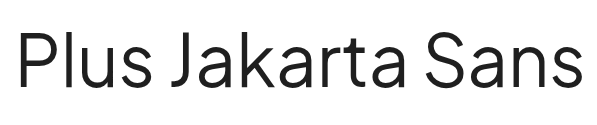

Figura 11 – Fonte Plus Jakarta Sans

Fonte: Os autores (2026)

## Paleta de cores

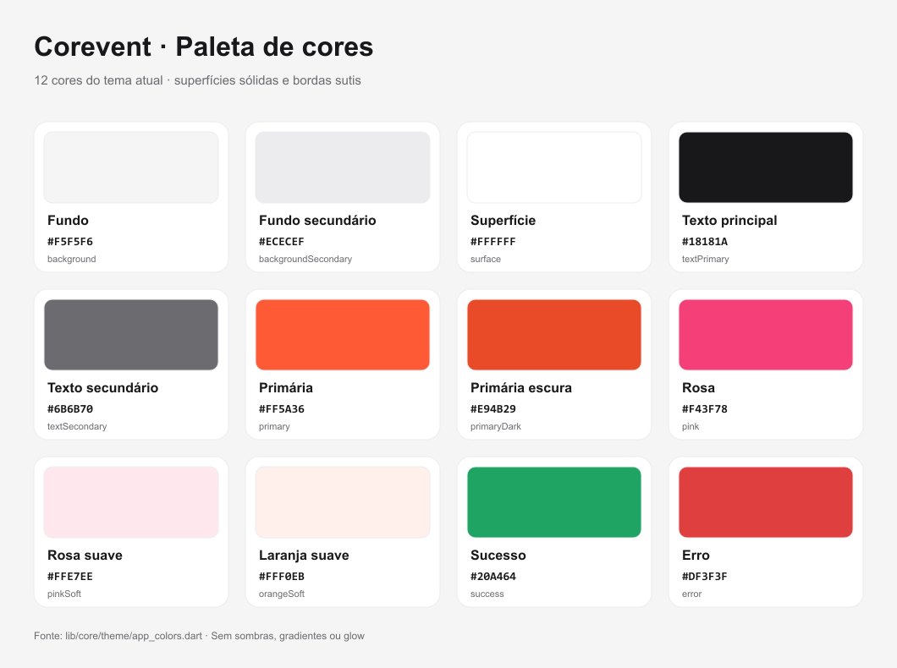

Figura 12 – Cores do projeto Fonte: Os autores (2026)

## Personas

### PERSONA 1 - “Participante lucas”

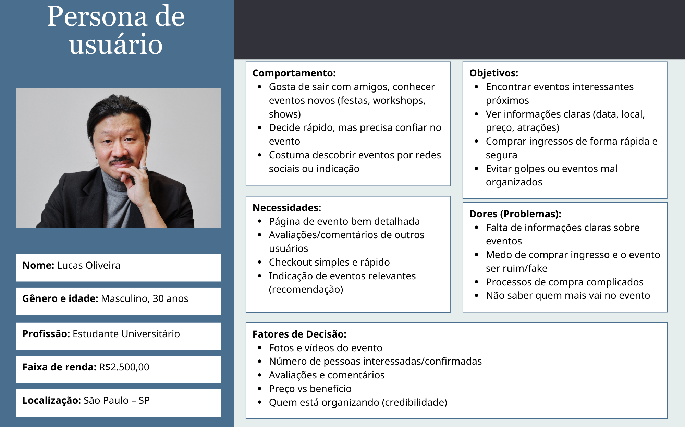

Figura 3 - Persona Participante Lucas

Fonte: Os autores (2026).

### PERSONA 2 - “Organizadora Mariana”

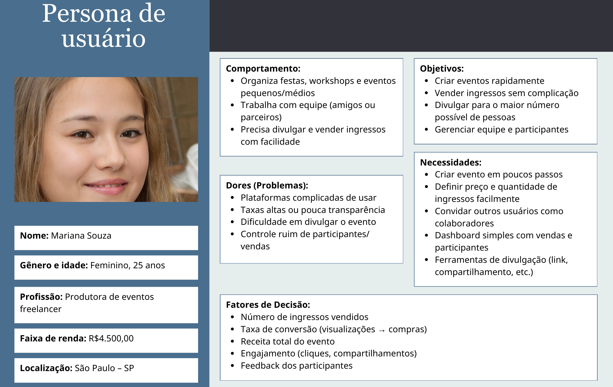

Figura 4 - Persona Organizadora Mariana

Fonte: Os autores (2026).

## Wireframes

Nosso wireframe da aplicação Mobile para participantes foi realizado utilizando o Figma. Abaixo se encontram algumas das telas:

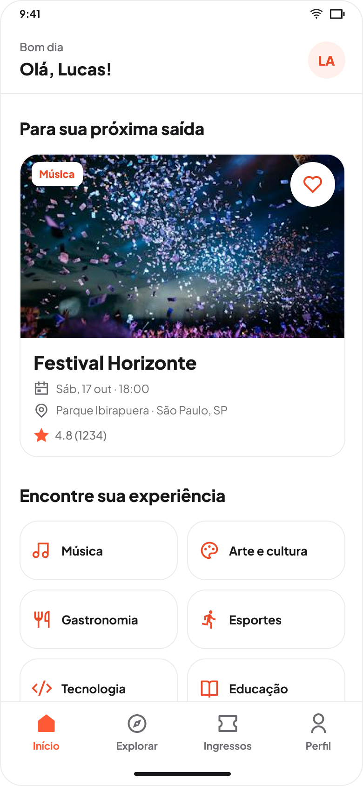

Figura 13 – Início

Fonte: Os autores (2026)

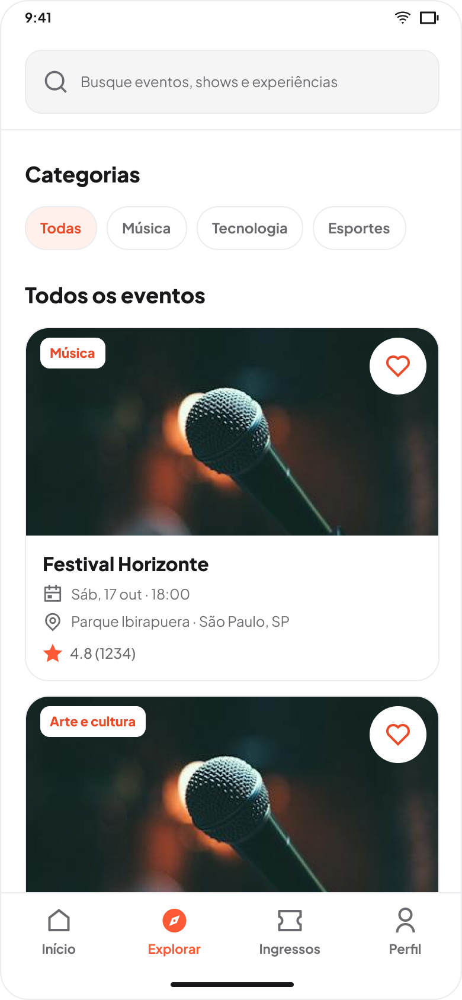

Figura 14 – Explorar

Fonte: Os autores (2026)

Figura 15 - Ingressos

Fonte: Os autores (2026)

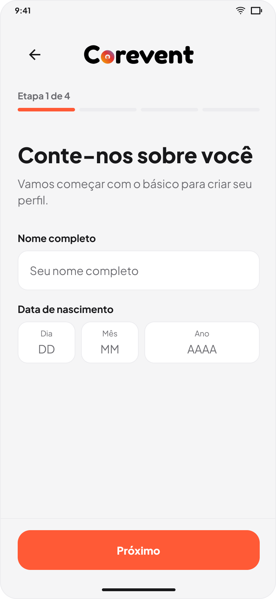

Figura 16 – Formulário de cadastro de usuário

Fonte: Os autores (2026)

Abaixo se encontram algumas das telas da aplicação Web, destinada aos organizadores de eventos:

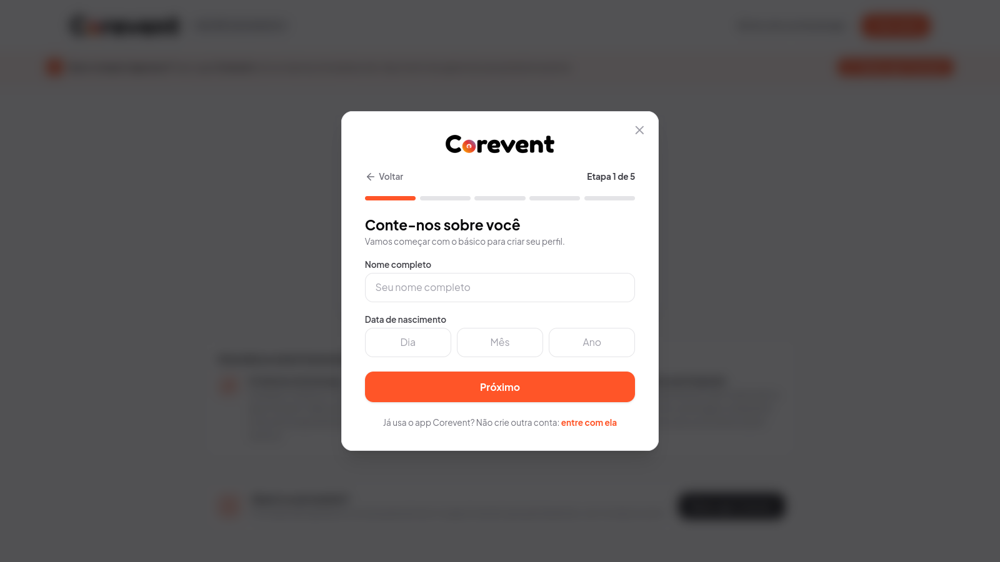

Figura 17 – Formulário de cadastro de usuário (Web)

Fonte: Os autores (2026)

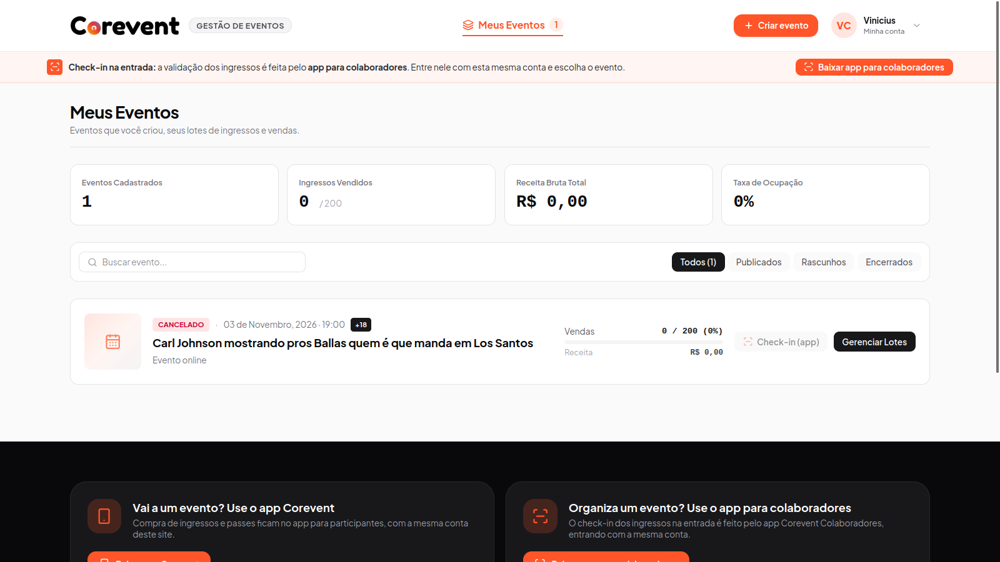

Figura 18 – Meus Eventos

Fonte: Os autores (2026)

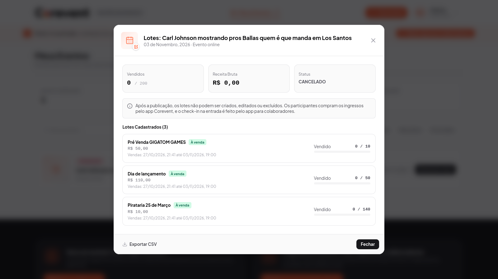

Figura 19 – Gerenciamento de lotes de ingressos

Fonte: Os autores (2026)

# 10. Protótipo

Figma: https://www.figma.com/design/ce5I8202kcPhVWE0SeW8aY/Telas-Corevent?node-id=0-1&t=AbmCVTskZsm3D3cu-1

# 11. Aplicação

A Aplicação possui dois ambientes: produção, destinado ao uso da aplicação e staging, utilizado para testes e validação de novas funcionalidades antes da publicação em produção.

Nos dois ambientes, a API está hospedada no Google Cloud Platform (GCP) utilizando o Cloud Run, e os arquivos e imagens são armazenados em buckets do Cloud Storage.

A documentação da API de testes está disponível em: https://corevent-staging-api-666040325433.us-central1.run.app/docs

A aplicação possui interfaces mobile e web. O código-fonte da aplicação mobile está disponível no repositório https://github.com/corevent/CoreventMobileApp, enquanto o código-fonte da aplicação web pode ser acessado no repositório https://github.com/corevent/corevent-web.

# 12. Considerações Finais

O desenvolvimento deste projeto permitiu a criação de uma aplicação com interfaces mobile e web voltada ao gerenciamento e à participação em eventos, oferecendo funcionalidades como cadastro de usuários, autenticação, criação e visualização de eventos e gerenciamento de ingressos. Foram utilizadas tecnologias como Flutter, NestJS, PostgreSQL e Docker, proporcionando experiência prática no desenvolvimento de aplicações, na integração entre serviços e no gerenciamento de bancos de dados.

O sistema também conta com integração ao ambiente sandbox do PagBank, permitindo testar os fluxos de compra de ingressos e confirmação de pagamentos sem realizar transações financeiras reais. Entretanto, o repasse dos valores arrecadados aos organizadores ainda não foi implementado, permanecendo como uma etapa necessária para a operação financeira completa da plataforma.

A utilização de ambientes separados de produção e staging, com serviços do Google Cloud Platform, contribui para a organização das implantações e a validação de alterações. Como continuidade do projeto, destacam-se a implementação do repasse aos organizadores, a evolução dos testes, o aprimoramento da segurança e a preparação da integração financeira para operar em produção.

Além do aprendizado técnico, o projeto contribuiu para o desenvolvimento do trabalho em equipe, da organização e da colaboração entre os integrantes, atendendo aos objetivos propostos no contexto acadêmico.

# 13. Referências

- [Canva](https://canva.com)
- [Claude Code](https://claude.com/product/claude-code)
- [Docker](https://www.docker.com)
- [Docker Hub](https://hub.docker.com)
- [Dotnet](https://dotnet.microsoft.com/pt-br/apps/maui)
- [Figma](https://figma.com)
- [Flutter](https://flutter.dev)
- [Github](https://github.com)
- [Google Cloud Plataform - GCP](https://cloud.google.com)
- [NeonDB](https://neon.com)
- [NestJS](https://nestjs.com)
- [Node.js](https://nodejs.org)
- [PagBank - Developer](https://developer.pagbank.com.br)
- [PostgreSQL](https://www.postgresql.org)
- [Scalar API](https://scalar.com)
- [Trello](https://trello.com)
- [UML - Object Management Group](https://www.omg.org/spec/UML/)